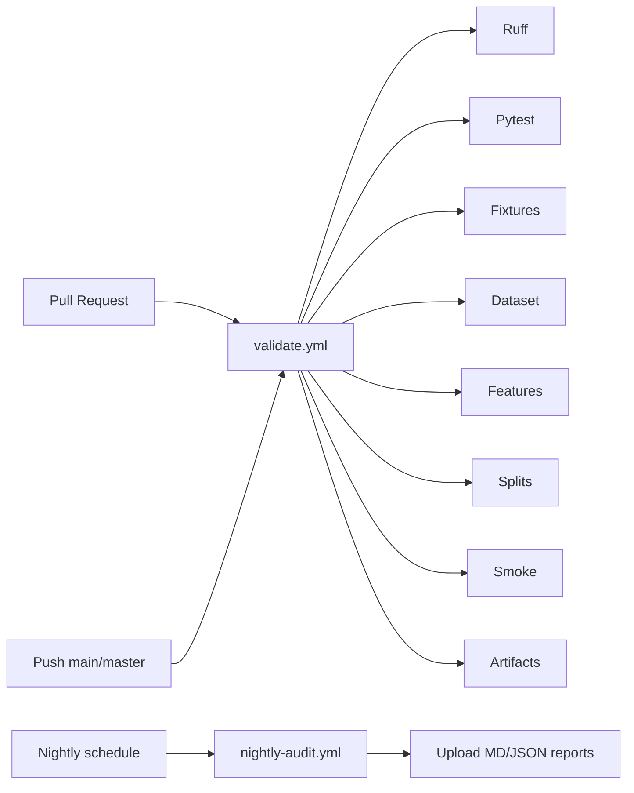

# CI Specification

## Purpose

Guarantee that every pull request and nightly build keeps the SER Research OS honest: lint, tests, dataset/feature/split validation, smoke training, and artifact contracts must all pass.

## GitHub Actions architecture



### `validate.yml`

Triggers: `push` and `pull_request` to `main`/`master`, plus `workflow_dispatch`.

Stages (fail immediately on first non-zero exit):

1. Checkout
2. Python 3.12 + pip cache
3. Install `requirements.txt`
4. Ruff (`python -m ruff check src scripts tests`)
5. Pytest
6. Prepare CI fixtures (`scripts/prepare_ci_fixtures.py --config config/ci.yaml`)
7. Dataset validation (`--allow-missing-audio` only if fixtures omit WAVs; prefer real tiny WAVs)
8. Feature validation
9. Split validation
10. Smoke test
11. Artifact validation (`--require-manifest`)

### `nightly-audit.yml`

Triggers: scheduled cron + `workflow_dispatch`.

Runs validation-oriented steps and uploads Markdown/JSON reports as workflow artifacts for historical auditing.

## Quality gates

| Gate | Local command | CI stage |
|---|---|---|
| Lint | `python -m ruff check ...` | Ruff |
| Tests | `pytest` | Pytest |
| Dataset | `validate_dataset.py` | Dataset Validation |
| Features | `validate_features.py` | Feature Validation |
| Splits | `validate_splits.py` | Split Validation |
| Smoke | `smoke_test.py` | Smoke Test |
| Artifacts | `check_artifacts.py` | Artifact Validation |

## Local CI workflow

Never rely on GitHub alone. Before declaring work complete:

```bash
python scripts/workflow.py ci-local
# or
.cursor/commands/ci_local.sh
```

This executes the same ordered stages defined in `scripts/workflows.yaml` under `ci-local`.

## Artifact verification

`scripts/check_artifacts.py` verifies:

- Required specification / script / package files exist
- No notebooks
- Label and mel geometry contracts
- Manifest/feature spot checks when present
- `results/results.csv` schema when present
- CI config does not write into production `results/`

## Failure policy

- Any stage exiting non-zero **fails the workflow**.
- Do **not** set `continue-on-error: true` on validation stages.
- Fix the first failing gate, then re-run locally before pushing.

## Merge policy

- `validate.yml` must be green on the PR head commit.
- Do not merge with failing Research OS gates.
- Release workflow (`python scripts/workflow.py release`) must PASS before tagging.

## Configuration notes

- Production experiments: `config/config.yaml`
- CI-only synthetic fixtures: `config/ci.yaml` (must not overwrite thesis results paths)
