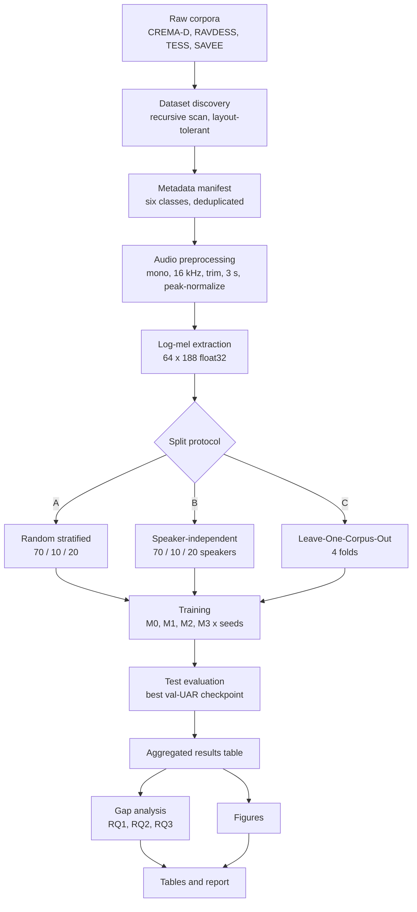
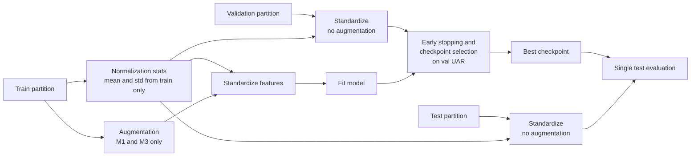
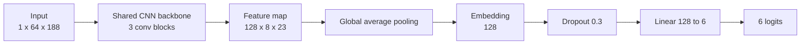

# SER Project Specification

**Status:** Authoritative. This document is the single source of truth for the repository. When code, configuration, README, or any other document disagrees with this specification, this specification wins and the other artifact must be corrected.

**Scope:** What the system must do and why. It does not describe how individual modules are coded, except where a design choice is part of the architecture or affects the validity of the experiments.

---

## 1. Project Vision

Build a reproducible, command-line-driven research framework for Speech Emotion Recognition (SER) that measures **how well SER models generalize** when the evaluation conditions are made progressively stricter.

The framework is intended to support a university thesis and a peer-reviewed paper. Every reported number must be regenerable from raw audio by running documented commands with fixed seeds.

The contribution is **not** a new neural architecture. It is a **controlled, single-pipeline generalization analysis**. The preprocessing, labels, models, optimizer, and metrics stay fixed. Only the evaluation protocol and two model factors (augmentation and temporal modeling) change.

---

## 2. Research Motivation

1. **Merged-corpus scores are often reported without a matching claim of transfer.** Many SER studies pool RAVDESS, CREMA-D, TESS, and SAVEE, apply augmentation, and report high accuracy on a random split. A high score on a pooled random split does not show that the model works on unseen speakers or unseen recording conditions.

2. **Random splits leak speaker identity.** When utterances are assigned to train and test at random, the same speaker appears on both sides. The model can then exploit voice and recording characteristics instead of emotional cues, which inflates results.

3. **Corpus shift is under-measured.** Each corpus has its own actors, recording setup, elicitation style (acted vs. semi-natural), and sentence set. A model that performs well within a corpus may fail on a different one.

4. **Component contributions are rarely isolated.** CNNs, BiLSTMs, log-mel features, and data augmentation are established techniques. Their individual and combined contributions under strict protocols are less well characterized.

---

## 3. Research Gap

> Existing SER studies use heterogeneous split protocols and often report strong results under conditions that are not directly comparable. It remains open to quantify, under **one fixed preprocessing and metric pipeline**:
>
> **(a)** how much apparent performance changes when speaker overlap between training and test is removed,
> **(b)** how much it degrades when an entire corpus is unseen during training, and
> **(c)** whether data augmentation and explicit temporal modeling still provide consistent gains under these stricter protocols, both separately and together.

This gap is deliberately narrow and falsifiable. The framework must not assume any outcome.

---

## 4. Research Questions

| ID | Question | Primary comparison |
|---|---|---|
| **RQ1** | How much does performance change between a random split and a speaker-independent split? | Protocol A vs. Protocol B, same models |
| **RQ2** | How much does performance drop under Leave-One-Corpus-Out evaluation, and which emotions account for the drop? | Protocol C folds vs. Protocols A and B |
| **RQ3** | What is the contribution of data augmentation and temporal modeling (BiLSTM), individually and jointly? | 2 × 2 ablation M0–M3 within each protocol |

---

## 5. Hypotheses

Each hypothesis is stated with its null form. The framework produces the evidence. The conclusion is determined by the data, not assumed in advance.

| ID | Hypothesis (H₁) | Null (H₀) | Tested by |
|---|---|---|---|
| **H1** | UAR under the speaker-independent split is lower than under the random split, for every model. | No systematic difference between Protocol A and Protocol B. | RQ1 table, Δ = B − A |
| **H2** | UAR under Leave-One-Corpus-Out is lower than under the speaker-independent split, averaged across the four held-out corpora. | Cross-corpus UAR is not lower than speaker-independent UAR. | RQ2 table vs. RQ1 table |
| **H2b** | The cross-corpus drop is not uniform across emotions. Some classes degrade substantially more than others. | Per-class recall drops are roughly uniform. | Per-emotion recall under Protocol C |
| **H3a** | Augmentation improves UAR (M1 > M0 and M3 > M2). | No augmentation effect. | RQ3 contrasts |
| **H3b** | Temporal modeling improves UAR (M2 > M0 and M3 > M1). | No temporal-modeling effect. | RQ3 contrasts |
| **H3c** | Augmentation and temporal modeling interact: their combined effect is not the sum of their individual effects. | Interaction term ≈ 0 (effects are additive). | RQ3 interaction term |
| **H3d** | The benefit of augmentation is larger under stricter protocols (B and C) than under the random protocol (A). | Augmentation effect is independent of protocol. | RQ3 contrasts compared across protocols |

### 5.1 Decision rule

An effect is reported as **consistent** only if both of the following hold:

1. The sign of the per-seed difference is the same for **all** seeds.
2. The absolute mean difference is larger than the standard deviation of that difference across seeds.

Effects that fail either condition are reported as **inconclusive**, not as evidence of absence. All deltas are reported with mean ± standard deviation across seeds, whether or not they are consistent.

---

## 6. Complete Pipeline Specification

### 6.1 Stages

| # | Stage | Input | Output | Invariant |
|---|---|---|---|---|
| 1 | Dataset discovery | Raw corpus folders | List of audio files per corpus | Tolerates nested and duplicated archive layouts |
| 2 | Metadata manifest | Audio file list | One row per unique utterance | Six-class labels only; duplicates removed |
| 3 | Audio preprocessing | Raw audio | Fixed 3 s, 16 kHz, mono waveform | Identical treatment for every file |
| 4 | Feature extraction | Waveform | Log-mel spectrogram, 64 × 188, float32 | Shape validated for every file |
| 5 | Split generation | Manifest | Train / val / test partitions per protocol and seed | No speaker leakage (Protocols B, C) |
| 6 | Augmentation | Training features | Randomly perturbed training features | Training partition only; seeded |
| 7 | Training | Train + val partitions | Best checkpoint by validation UAR | Test partition never used for selection |
| 8 | Evaluation | Best checkpoint + test partition | Test metrics | One evaluation per run |
| 9 | Ablation runner | Protocols × models × seeds | Aggregated results table | Every combination executed |
| 10 | Gap analysis | Aggregated results | RQ1–RQ3 tables (CSV + Markdown) | Mean ± std across seeds |
| 11 | Visualization and report | Results and run histories | PNG figures and report | No notebooks |

### 6.2 Pipeline diagram



### 6.3 Data flow within one run



---

## 7. Dataset Specification

### 7.1 Corpora

| Corpus | Speakers | Speaker identity source | Emotion label source | Notes |
|---|---:|---|---|---|
| CREMA-D | 91 | Actor ID in file name | Emotion code in file name | Largest corpus; multiple sentences and intensities |
| RAVDESS | 24 | Actor folder / actor field | Emotion field in file name | Speech modality only; archive may contain duplicate trees |
| TESS | 2 | Speaker prefix (older / younger female) | Folder name or file-name suffix | Only two speakers; drives special split rules |
| SAVEE | 4 | Speaker folder (DC, JE, JK, KL) or file-name prefix | Emotion code prefix in file name | Male speakers only; neutral has twice as many clips as each other emotion |

### 7.2 Label taxonomy

All corpora map to exactly six classes. The mapping is defined in one place and nowhere else.

| Class ID | Class |
|---:|---|
| 0 | angry |
| 1 | disgust |
| 2 | fear |
| 3 | happy |
| 4 | neutral |
| 5 | sad |

**Discarded emotions:** calm, surprise, pleasant surprise (including all spelling variants). Utterances with a discarded emotion are excluded from the manifest.

### 7.3 Manifest schema

Every row is one unique utterance.

| Column | Type | Description |
|---|---|---|
| `filepath` | string | Absolute path to the source audio |
| `dataset` | string | One of CREMA-D, RAVDESS, TESS, SAVEE |
| `speaker` | string | Corpus-prefixed speaker ID, unique across corpora |
| `emotion` | string | One of the six class names |
| `label` | int | Class ID from §7.2 |
| `duration` | float | Original audio duration in seconds |
| `split` | string | Partition role when exported with a split |
| `feature_path` | string | Path to the extracted feature file |

### 7.4 Deduplication rule

An utterance is identified by *(corpus, speaker, file name)*. When several physical copies share that identity (for example, duplicate RAVDESS trees in a downloaded archive), exactly one copy is kept. Duplicate copies must never appear as separate samples, because they would leak identical audio across partitions.

### 7.5 Reference statistics (after mapping and deduplication)

| Corpus | angry | disgust | fear | happy | neutral | sad | Total | Speakers |
|---|---:|---:|---:|---:|---:|---:|---:|---:|
| CREMA-D | 1271 | 1271 | 1271 | 1271 | 1087 | 1271 | 7442 | 91 |
| RAVDESS | 192 | 192 | 192 | 192 | 96 | 192 | 1056 | 24 |
| TESS | 400 | 400 | 400 | 400 | 400 | 400 | 2400 | 2 |
| SAVEE | 60 | 60 | 60 | 60 | 120 | 60 | 420 | 4 |
| **Total** | **1923** | **1923** | **1923** | **1923** | **1703** | **1923** | **11318** | **121** |

A regenerated manifest that deviates from these counts indicates a discovery, mapping, or deduplication defect.

---

## 8. Preprocessing Specification

Every utterance is converted into an identical input representation.

### 8.1 Audio

| Step | Specification |
|---|---|
| Channels | Downmix to mono |
| Sample rate | Resample to 16 000 Hz |
| Silence trimming | Trim leading and trailing silence below 30 dB relative to peak |
| Length | Exactly 3.0 s (48 000 samples) |
| Longer clips | Center crop to 3.0 s |
| Shorter clips | Zero-pad at the end to 3.0 s |
| Amplitude | Peak-normalize to max \|x\| = 1 (skip silent clips) |

### 8.2 Log-mel spectrogram

| Parameter | Value |
|---|---|
| Sample rate | 16 000 Hz |
| FFT size | 512 |
| Window length | 512 |
| Hop length | 256 |
| Mel bands | 64 |
| Frequency range | 20 – 8000 Hz |
| Power | 2.0 (power spectrogram) |
| Framing | Centered STFT |
| Scale | Decibels relative to the per-utterance maximum |
| Output shape | **64 × 188** (mel × frames) |
| Storage dtype | float32 |

The number of frames follows from ⌊48 000 / 256⌋ + 1 = 188. Any feature that does not have exactly this shape is a hard error.

### 8.3 Feature storage

- One feature file per utterance, grouped by corpus: `data/processed/features/{dataset}/…`
- Existing features are **not** recomputed unless an explicit overwrite option is given.
- Files that fail to decode are excluded and listed in a failure log. They are never silently replaced.

### 8.4 Normalization

Features are standardized with a single global mean and standard deviation computed on the **training partition of the current run only**. Validation and test use the training statistics. Statistics are never computed on validation or test data.

---

## 9. Augmentation Specification

### 9.1 Rules

1. Augmentation is applied **only** to training samples of models M1 and M3.
2. Validation and test samples are **never** augmented, for any model.
3. Augmentation is applied on the fly to log-mel features, so each epoch sees different perturbations.
4. Each transform has an independent, configurable probability.
5. The pipeline is composed from configuration and is deterministic for a given seed.

### 9.2 Transforms (applied in this order)

| # | Transform | Operation on the log-mel spectrogram | Probability | Magnitude |
|---|---|---|---:|---|
| 1 | Time shift | Circular shift along time | 0.25 | ±12 frames |
| 2 | Random gain | Multiply by a random linear gain | 0.30 | ±6 dB |
| 3 | Gaussian noise | Add zero-mean Gaussian noise | 0.35 | σ = 0.03 |
| 4 | Pitch shift | Shift along the mel axis (feature-domain approximation) | 0.25 | ±2 mel bins |
| 5 | Time stretch | Resample along time, then crop or pad to 188 frames | 0.25 | rate ∈ [0.9, 1.1] |
| 6 | SpecAugment | Zero one time band and one frequency band | 0.35 (each band 0.35) | ≤ 24 frames, ≤ 8 mel bins |

### 9.3 Validity notes

- Pitch shift and time stretch are **feature-domain approximations**, not waveform-domain signal processing. Methods sections must describe them as such.
- Augmentation never changes the output shape (64 × 188).

---

## 10. Model Specification

### 10.1 Experiment variants (2 × 2 design)

| Model | Temporal module | Augmentation |
|---|:---:|:---:|
| **M0** | none (CNN) | no |
| **M1** | none (CNN) | yes |
| **M2** | BiLSTM | no |
| **M3** | BiLSTM | yes |

M0 and M1 share one architecture, and so do M2 and M3. The only difference within each pair is augmentation.

### 10.2 Shared CNN backbone

One backbone definition is reused by both classifiers. It must not be duplicated.

| Layer | Operation | Output (C × F × T) |
|---|---|---|
| Input | log-mel | 1 × 64 × 188 |
| Block 1 | Conv 3×3 (pad 1) → BatchNorm → ReLU → MaxPool 2×2 | 32 × 32 × 94 |
| Block 2 | Conv 3×3 (pad 1) → BatchNorm → ReLU → MaxPool 2×2 | 64 × 16 × 47 |
| Block 3 | Conv 3×3 (pad 1) → BatchNorm → ReLU → MaxPool 2×2 | 128 × 8 × 23 |

Channel widths (32, 64, 128) are configurable.

### 10.3 CNN classifier (M0, M1)



### 10.4 CNN-BiLSTM classifier (M2, M3)

The backbone feature map is pooled over frequency and read as a time sequence of 23 steps, each a 128-dimensional vector.

```mermaid
flowchart LR
    X["Input<br/>1 x 64 x 188"] --> BB["Shared CNN backbone<br/>3 conv blocks"]
    BB --> FM["Feature map<br/>128 x 8 x 23"]
    FM --> FP["Average over frequency"]
    FP --> SEQ["Sequence<br/>23 steps x 128"]
    SEQ --> LSTM["BiLSTM<br/>hidden 128 per direction"]
    LSTM --> TP["Mean over time"]
    TP --> EMB["Embedding<br/>256"]
    EMB --> DO["Dropout 0.3"]
    DO --> FC["Linear 256 to 6"]
    FC --> Y["6 logits"]
```



### 10.5 Architectural contracts

- Input must be exactly `(batch, 1, 64, 188)`. Any other shape is rejected.
- Output must be exactly `(batch, 6)`.
- Reference parameter counts: CNN ≈ 93.7 k, CNN-BiLSTM ≈ 358.6 k. Parameter counts must be reported for every model.

### 10.6 Training specification

| Setting | Value |
|---|---|
| Loss | Cross-entropy with inverse-frequency class weights computed from the training partition |
| Optimizer | AdamW (Adam is also supported) |
| Learning rate | 1 × 10⁻³ |
| Weight decay | 1 × 10⁻⁴ |
| Batch size | 32 |
| Maximum epochs | 40 |
| Gradient clipping | L2 norm ≤ 5.0 |
| LR scheduler | Reduce on plateau of validation UAR: factor 0.5, patience 2, min LR 1 × 10⁻⁶ |
| Early stopping | On validation UAR, patience 8 epochs |
| Checkpoint | Best validation UAR only |
| Mixed precision | Enabled when the device supports it |
| Device priority | Apple MPS → CUDA → CPU |
| Seeds | 42, 43, 44 |

All hyperparameters live in the configuration file. Command-line overrides are allowed and must be recorded in each run's saved configuration.

---

## 11. Evaluation Protocol Specification

### 11.1 Overview


### 11.2 Protocol A: Random stratified split

- Unit of assignment: the utterance.
- Proportions: 70 % train, 10 % validation, 20 % test, stratified by emotion label.
- Speakers intentionally overlap. This protocol reproduces the common literature setting and serves as the optimistic reference for RQ1.

### 11.3 Protocol B: Speaker-independent split

- Unit of assignment: the speaker. Every utterance of a speaker goes to one partition.
- Assignment is done **within each corpus** with a 70 / 10 / 20 split of speakers, so every corpus contributes to training and to test.
- Each corpus with at least three speakers has at least one validation speaker and at least one test speaker.
- **TESS rule:** TESS has two speakers. One speaker goes to train and the other to test. TESS contributes no validation speaker. Its would-be validation share is absorbed into training.
- Invariant: the train, validation, and test speaker sets are pairwise disjoint.

### 11.4 Protocol C: Leave-One-Corpus-Out

- Four folds. In each fold, one corpus is the entire test set and the other three form the training pool.

| Fold | Training corpora | Test corpus |
|---|---|---|
| C1 | RAVDESS + TESS + SAVEE | CREMA-D |
| C2 | CREMA-D + TESS + SAVEE | RAVDESS |
| C3 | CREMA-D + RAVDESS + TESS | SAVEE |
| C4 | CREMA-D + RAVDESS + SAVEE | TESS |

- Validation is drawn **only** from the training pool, split by speaker within each pool corpus, with at least one validation speaker per corpus.
- The held-out corpus is never used for normalization statistics, class weights, early stopping, checkpoint selection, or hyperparameter choice.
- Every utterance in the training pool is assigned to train or validation. None are discarded.

### 11.5 Reproducibility and storage

- Every split is a deterministic function of *(manifest, protocol, seed)*.
- Splits are exported as CSV files (train, val, test, combined, plus a summary) under `data/splits/`, one folder per protocol, fold, and seed.
- Integrity is verified automatically before training:
  - partitions cover the manifest exactly, with no duplicates;
  - no speaker is in more than one partition (Protocols B and C);
  - in Protocol C, the test set contains exactly one corpus and that corpus is absent from train and validation.

### 11.6 Reference partition sizes (seed 42)

| Split | Train | Val | Test | Speakers (train / val / test) |
|---|---:|---:|---:|---|
| A: random | 7922 | 1131 | 2265 | 121 / 121 / 121 (overlapping) |
| B: speaker-independent | 7392 | 931 | 2995 | 84 / 12 / 25 |
| C1: test CREMA-D | 2439 | 1437 | 7442 | 25 / 5 / 91 |
| C2: test RAVDESS | 8056 | 2206 | 1056 | 84 / 13 / 24 |
| C3: test SAVEE | 8664 | 2234 | 420 | 102 / 15 / 4 |
| C4: test TESS | 7779 | 1139 | 2400 | 104 / 15 / 2 |

### 11.7 Experiment matrix

| Dimension | Values | Count |
|---|---|---:|
| Evaluation conditions | A, B, C1, C2, C3, C4 | 6 |
| Models | M0, M1, M2, M3 | 4 |
| Seeds | 42, 43, 44 | 3 |
| **Total training runs** | | **72** |

---

## 12. Metrics Specification

### 12.1 Metrics

| Metric | Definition | Role |
|---|---|---|
| **UAR** (unweighted average recall) | Mean of per-class recall over the 6 classes | **Primary metric**; early stopping; hypothesis tests |
| Macro-F1 | Mean of per-class F1 | Co-primary metric |
| Accuracy | Correct predictions / total | Secondary; comparability with literature |
| Macro precision | Mean of per-class precision | Secondary |
| Macro recall | Mean of per-class recall (equal to UAR) | Reported for completeness |
| Confusion matrix | 6 × 6 counts, rows = true class | Error analysis |
| Classification report | Per-class precision, recall, F1, support | Error analysis; RQ2 per-emotion analysis |

ROC and AUC metrics are out of scope.

### 12.2 When metrics are computed

- Train and validation metrics after **every** epoch.
- Test metrics **once** per run, on the best-validation-UAR checkpoint.

### 12.3 Aggregation

- Mean ± standard deviation across seeds for every protocol, fold, and model cell.
- Protocol C is reported both per held-out corpus and as the mean over the four folds.
- Deltas are computed per seed first, then aggregated.

### 12.4 RQ3 contrasts (computed per protocol)

| Contrast | Formula |
|---|---|
| Augmentation effect, CNN | M1 − M0 |
| Augmentation effect, CNN-BiLSTM | M3 − M2 |
| Temporal effect, no augmentation | M2 − M0 |
| Temporal effect, with augmentation | M3 − M1 |
| Interaction | (M3 − M2) − (M1 − M0) |

---

## 13. Expected Outputs

### 13.1 Per run

One folder per run, identified by protocol, fold, model, and seed:

```text
artifacts/runs/{protocol}_{model}_seed{seed}/   # fold suffix added for LOCO
├── config.yaml            # exact configuration used, including CLI overrides
├── history.csv            # per-epoch metrics
├── best_model.pt          # best-validation-UAR checkpoint
├── metrics.json           # test metrics, run metadata, seed, device
├── confusion_matrix.png   # test confusion matrix
└── report.txt             # human-readable run summary
```

Canonical path key: `paths.outputs_dir` in `config/config.yaml` (default `artifacts/runs`).

`history.csv` columns: `epoch, train_loss, val_loss, train_accuracy, val_accuracy, val_uar, val_macro_f1, learning_rate`. Additional columns are allowed.

### 13.2 Aggregated results

`results/results.csv` has one row per run. Required columns:

| Column | Description |
|---|---|
| `protocol` | random, speaker_independent, leave_one_corpus_out |
| `model` | M0–M3 |
| `seed` | integer seed |
| `dataset_fold` | `all` for A and B; held-out corpus name for C |
| `accuracy` | test accuracy |
| `uar` | test UAR |
| `macro_f1` | test macro-F1 |
| `precision` | test macro precision |
| `recall` | test macro recall |

Per-class precision, recall, and F1 columns are also required, because RQ2 needs them.

### 13.3 Gap-analysis tables (CSV and Markdown)

| Table | Rows | Columns |
|---|---|---|
| RQ1 | M0–M3 | Accuracy, UAR, Macro-F1 for A and B (mean ± std) and Δ (B − A) |
| RQ2 | Model × held-out corpus | Training corpora, test corpus, Accuracy, UAR, Macro-F1 (mean ± std) |
| RQ2-b | Model × emotion | Per-class recall under Protocol C |
| RQ3 | M0–M3 per protocol | Augmentation flag, BiLSTM flag, Accuracy, UAR, Macro-F1, Δ vs. M0 |
| RQ3 contrasts | Contrast per protocol | Mean ± std of Δ UAR and consistency verdict (§5.1) |

### 13.4 Figures (PNG only)

- Training curves per run: loss, accuracy, UAR, macro-F1.
- Confusion matrix per run.
- Bar chart comparing protocols (grouped by model).
- Bar chart comparing models (per protocol, with seed error bars).
- Per-emotion recall under Leave-One-Corpus-Out.

---

## 14. Definition of Done

The project is complete when **every** item below is true.

### 14.1 Data

- [ ] The manifest regenerates from raw corpora with the counts in §7.5 (11 318 utterances, 121 speakers).
- [ ] No discarded emotion appears in the manifest.
- [ ] No duplicate utterance appears in the manifest.
- [ ] Every feature file exists, is float32, and has shape 64 × 188.

### 14.2 Splits

- [ ] All six evaluation conditions (A, B, C1–C4) are exported for every seed.
- [ ] Automated integrity checks pass: coverage, no duplicates, no speaker leakage (B, C), and a held-out corpus absent from training (C).
- [ ] The TESS rule in Protocol B is enforced.
- [ ] Regenerating a split with the same seed produces identical partitions.

### 14.3 Training and evaluation

- [ ] All 72 runs in §11.7 complete, with no manual intervention between runs.
- [ ] Every run folder contains all artifacts in §13.1.
- [ ] Augmentation is active for M1 and M3 training only. It is never applied to validation or test.
- [ ] Test data is never used for normalization, class weights, early stopping, or checkpoint selection.
- [ ] Every run records its seed, device, configuration, and parameter count.

### 14.4 Analysis and reporting

- [ ] `results/results.csv` contains 72 rows with all required columns, and it contains **only** real experiment runs.
- [ ] RQ1, RQ2, and RQ3 tables exist in CSV and Markdown with mean ± std across seeds.
- [ ] RQ3 contrasts include the interaction term and a consistency verdict.
- [ ] All figures in §13.4 are generated as PNG.
- [ ] Every hypothesis in §5 is marked supported, not supported, or inconclusive, with a pointer to the table that decides it.

### 14.5 Reproducibility and engineering

- [ ] The full pipeline runs from the repository root with command-line entry points only. No notebooks.
- [ ] Seeds are set for Python, NumPy, PyTorch, CUDA, and MPS.
- [ ] All hyperparameters come from configuration, and overrides are recorded.
- [ ] Automated tests for splits, models, and analysis pass.
- [ ] The methods section reports the limitations in §15.

---

## 15. Known Limitations and Threats to Validity

These must be reported in the thesis and paper, not hidden.

1. **TESS has two speakers.** Strict three-way speaker-disjoint partitioning inside TESS is impossible. In Protocol B, TESS contributes one training speaker and one test speaker. Test results on TESS reflect a single speaker.
2. **Validation composition in Protocol C.** Validation speakers are drawn per pool corpus. Two-speaker TESS therefore puts one entire speaker (about 1200 utterances) into validation, so validation can be dominated by one corpus in some folds. For example, in fold C1, TESS provides most of the 1437 validation utterances. Model selection may favor that corpus.
3. **Small held-out corpora.** SAVEE (420 utterances, 4 speakers) and RAVDESS (1056 utterances) give high-variance test estimates in Protocol C.
4. **Class imbalance.** Neutral is under-represented in CREMA-D and RAVDESS and over-represented in SAVEE. Class weights and UAR mitigate this but do not remove it.
5. **Feature-domain augmentation.** Pitch shift and time stretch approximate their waveform-domain counterparts. Conclusions about "augmentation" apply to this specific augmentation set.
6. **Acted speech.** All four corpora are acted or elicited. Generalization to spontaneous speech is out of scope.
7. **Gender and speaker demographics differ across corpora** (for example, SAVEE is all male and TESS all female), which confounds corpus shift with speaker demographics in Protocol C.
