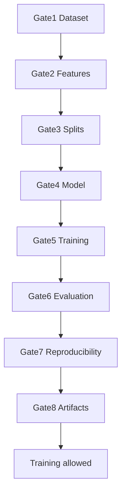

# Validation Protocol

**Status:** Binding. This document defines every validation gate that protects the research claims in [`SER_PROJECT_SPEC.md`](SER_PROJECT_SPEC.md).

**Hard rule:** Never start a real training matrix (`scripts/run_experiments.py` on production data) if any pre-training gate fails.

**Orchestrator:**

```bash
python scripts/workflow.py pre-training
python scripts/workflow.py ci-local
```

---

## Gate overview



| Gate | Name | Script | Blocks training? |
|---|---|---|:---:|
| 1 | Dataset Integrity | `scripts/validate_dataset.py` | Yes |
| 2 | Feature Integrity | `scripts/validate_features.py` | Yes |
| 3 | Split Integrity | `scripts/validate_splits.py` | Yes |
| 4 | Model Integrity | `tests/test_models.py` | Yes |
| 5 | Training Integrity | `scripts/smoke_test.py` + pre-training audit | Yes |
| 6 | Evaluation Integrity | metrics contracts / `check_artifacts.py` | Yes |
| 7 | Reproducibility | `scripts/reproducibility_check.py` | Yes |
| 8 | Artifact Integrity | `scripts/check_artifacts.py` | Yes |

---

## Gate 1 — Dataset Integrity

### Objective

Confirm the unified manifest is complete, labelled correctly, and backed by readable audio.

### Research risk

Duplicate paths, discarded emotions, or corrupted WAVs silently bias every downstream metric and make RQ1–RQ3 incomparable.

### CLI command

```bash
python scripts/validate_dataset.py --config config/config.yaml
```

### Expected output

```text
DATASET VALIDATION PASSED
```

Writes `artifacts/reports/VALIDATION_REPORT.md` and `artifacts/reports/validation_dataset.json`.

### Failure condition

Non-zero exit. Missing metadata columns, duplicate filepath, unexpected emotions, missing corpora, or unreadable WAV samples.

### Recovery procedure

1. Re-run `python scripts/prepare_manifest.py --config config/config.yaml`.
2. Repair or remove corrupted audio files.
3. Re-run validate_dataset until PASS.

---

## Gate 2 — Feature Integrity

### Objective

Confirm every `feature_path` exists with shape `(64, 188)`, dtype `float32`, and no NaN/Inf.

### Research risk

Wrong feature geometry invalidates model contracts and makes training curves meaningless.

### CLI command

```bash
python scripts/validate_features.py --config config/config.yaml
```

### Expected output

```text
FEATURE VALIDATION PASSED
```

### Failure condition

Missing `.npy`, wrong shape/dtype, NaN/Inf, or extreme out-of-range values.

### Recovery procedure

```bash
python scripts/preprocess.py --config config/config.yaml --overwrite
python scripts/validate_features.py --config config/config.yaml
```

---

## Gate 3 — Split Integrity

### Objective

Validate Protocols A/B/C: stratification, speaker disjointness, and Leave-One-Corpus-Out isolation.

### Research risk

Speaker or corpus leakage inflates scores and falsifies RQ1/RQ2.

### CLI command

```bash
python scripts/validate_splits.py --config config/config.yaml --seed 42
python scripts/validate_splits.py --config config/config.yaml --seed 43
python scripts/validate_splits.py --config config/config.yaml --seed 44
```

The `pre-training` workflow validates all three seeds (42, 43, 44).

### Expected output

```text
SPLIT VALIDATION PASSED
```

### Failure condition

Speaker overlap (B/C), corpus leakage (C), failed integrity assertions, or broken stratification (A).

### Recovery procedure

```bash
python scripts/make_splits.py --config config/config.yaml --seed 42
python scripts/make_splits.py --config config/config.yaml --seed 43
python scripts/make_splits.py --config config/config.yaml --seed 44
python scripts/validate_splits.py --config config/config.yaml --seed 42
python scripts/validate_splits.py --config config/config.yaml --seed 43
python scripts/validate_splits.py --config config/config.yaml --seed 44
```

---

## Gate 4 — Model Integrity

### Objective

Confirm CNN / CNN-BiLSTM shared backbone, input shape `1×64×188`, and M0–M3 wiring.

### Research risk

Divergent backbones make the RQ3 ablation invalid.

### CLI command

```bash
python -m pytest tests/test_models.py -q
```

### Expected output

```text
... passed
```

### Failure condition

Any assertion failure on shapes, shared backbone, or augmentation mapping.

### Recovery procedure

Fix `src/ser/models.py` to match `docs/SER_PROJECT_SPEC.md`, then re-run tests.

---

## Gate 5 — Training Integrity

### Objective

Prove the trainer can execute one epoch end-to-end on synthetic data without crashing.

### Research risk

Broken loaders, device selection, or checkpointing wastes multi-hour experiment matrices.

### CLI command

```bash
python scripts/smoke_test.py
```

### Expected output

```text
SMOKE TEST PASSED
```

### Failure condition

Non-zero exit, missing metrics keys, or device/runtime exceptions.

### Recovery procedure

Inspect `src/ser/train.py` and smoke traceback; fix; re-run smoke_test.

---

## Gate 6 — Evaluation Integrity

### Objective

Confirm metrics contracts (Accuracy, UAR, macro precision/recall/F1, confusion matrix) and results schema.

### Research risk

Wrong metric definitions invalidate gap-analysis tables for RQ1–RQ3.

### CLI command

```bash
python -m pytest tests/test_metrics.py -q
python scripts/check_artifacts.py --config config/config.yaml
```

### Expected output

Tests pass; `ARTIFACTS CHECK PASSED`.

### Failure condition

Metric mismatch, illegal results.csv columns/values, or missing required repository files.

### Recovery procedure

Align `src/ser/metrics.py` / `src/ser/analysis.py` with the spec; regenerate results if needed.

---

## Gate 7 — Reproducibility

### Objective

Confirm identical logits for two seeded forward passes and log seed/device metadata.

### Research risk

Non-determinism prevents seed-averaged claims required by the thesis.

### CLI command

```bash
python scripts/reproducibility_check.py --config config/config.yaml --seed 42
```

### Expected output

```text
REPRODUCIBILITY PASSED
```

### Failure condition

Forward-pass outputs differ under the same seed.

### Recovery procedure

Verify `seed_everything` coverage; avoid nondeterministic ops in the checked path; re-run.

---

## Gate 8 — Artifact Integrity

### Objective

Confirm required repository files, config contracts, feature geometry, and optional results.csv hygiene.

### Research risk

Missing contracts mean experiments cannot be regenerated by another researcher.

### CLI command

```bash
python scripts/check_artifacts.py --config config/config.yaml --require-manifest
```

### Expected output

```text
ARTIFACTS CHECK PASSED
```

### Failure condition

Missing required files, notebooks present, label/mel mismatches, or corrupt results.csv.

### Recovery procedure

Restore missing files from the spec; remove notebooks; fix config; re-run check.

---

## Pass / Fail checklist

Before training:

- [ ] Gate 1 Dataset PASS
- [ ] Gate 2 Features PASS
- [ ] Gate 3 Splits PASS
- [ ] Gate 4 Models PASS
- [ ] Gate 5 Smoke PASS
- [ ] Gate 6 Evaluation contracts PASS
- [ ] Gate 7 Reproducibility PASS
- [ ] Gate 8 Artifacts PASS
- [ ] `PRE_TRAINING_AUDIT.md` overall PASS

After training:

- [ ] `python scripts/workflow.py post-training` PASS
- [ ] `POST_TRAINING_AUDIT.md` generated
- [ ] `artifacts/reports/training_health.json` generated
- [ ] Training curves annotated

---

## Aggregate commands

```bash
# Full pre-training gate stack
python scripts/workflow.py pre-training

# Local CI (uses config/ci.yaml fixtures)
python scripts/workflow.py ci-local

# Post-training
python scripts/workflow.py post-training
```
